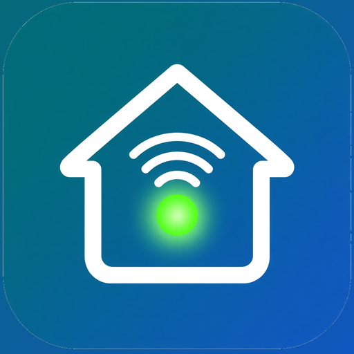
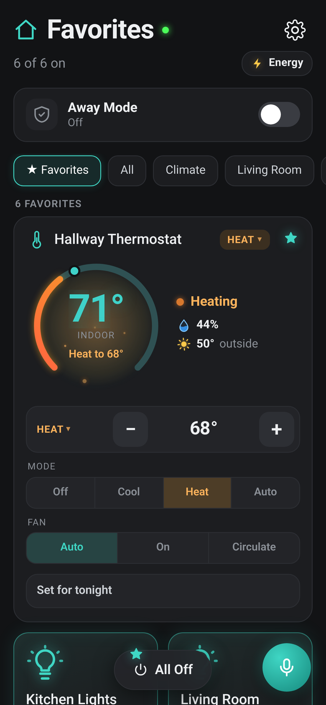
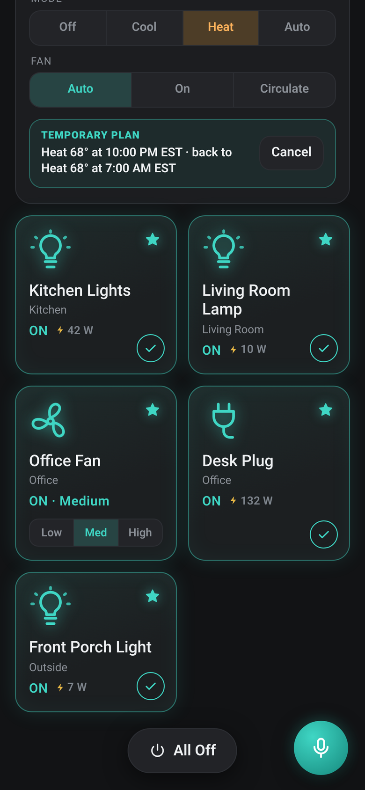
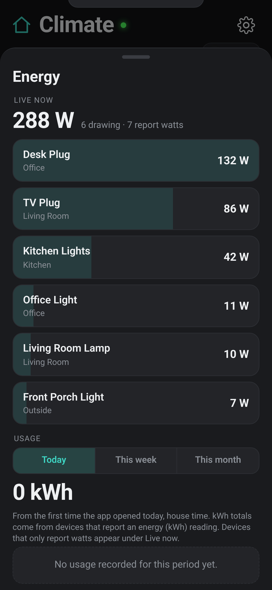
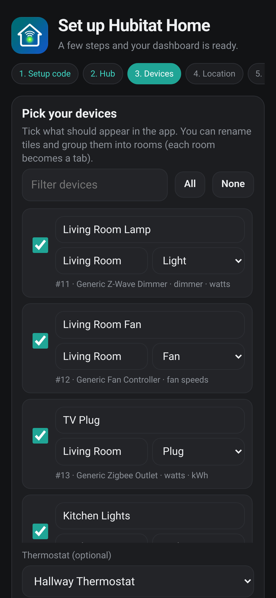

<p align="center"></p>

# Hubitat Home

A fast, good-looking phone dashboard for your **Hubitat Elevation** hub. It installs to your home screen like an app and runs **free on your own Cloudflare account**: your dashboard, your account, your home.

[](https://deploy.workers.cloudflare.com/?url=https://github.com/beowulf2014/hubitat-home)

<p align="center">
  
  
  
  
</p>

*(Screenshots use a made-up demo house.)*

## What it does

- **Favorites and custom layouts.** Star any tile; press and hold to move, resize or hide tiles. Each person gets their own.
- **Rooms as tabs**, lights, dimmers (always go to 100%), fans with speeds, plugs and switches.
- **Thermostat control** with a live dial, plus one-time **“Set for tonight”** plans (e.g. Heat 70° at 10 PM, then Cool 76° at 7 AM). No recurring schedule to manage.
- **Energy view.** Live watts and today / this week / this month kWh from devices that report power or energy, with an optional cost estimate.
- **Outdoor temperature** for your location (Open-Meteo, free, no account).
- **Phone alerts** from your own rules: “Closet light on over 20 minutes”, “Porch light on between 1 AM and 5 AM”.
- **Away Mode button** for a virtual switch, **voice control**, optional **UniFi Protect** button.
- **Update pop-up**: when you deploy a new version, the app offers “Update now”.
- A **setup wizard**: no code to edit, nothing to type into config files.

## What you need

- A Hubitat Elevation hub with the built-in **Maker API** app.
- A free **Cloudflare** account ([sign up](https://dash.cloudflare.com/sign-up)). The free Workers plan is plenty.
- A **GitHub** account (only for the one-click Deploy button).

## 1. Turn on Maker API on your hub

1. Open your hub’s web page (find it at [find.hubitat.com](https://find.hubitat.com) or use your hub’s IP address).
2. In the left sidebar choose **Apps**.
3. Top right, choose **Add Built-In App** (on newer firmware: **Add App**), then pick **Maker API** from the list.
4. Under **Select Devices**, tick every device you want in the dashboard (lights, switches, fans, plugs, thermostat, an “Away” virtual switch if you use one).
5. Select **Update**. If you see an option to allow **cloud** (remote) access, turn it on.
6. Scroll down to the example links. Under the **Cloud** endpoints, find **Get All Devices** and copy that link. It looks like
   `https://cloud.hubitat.com/api/<hub-id>/apps/<number>/devices/all?access_token=<token>`
   Keep it private: it works like a password for those devices.
7. Select **Done**.

> Cloudflare can’t reach your home network, so you need the **cloud** link, not the local `http://192.168…` one.

## 2. Deploy to your Cloudflare account

### Option A: one click (easiest)

1. Click **Deploy to Cloudflare** above and sign in to Cloudflare.
2. Connect your GitHub account when asked. Cloudflare makes your own copy of this project.
3. On the setup page:
   - **Project / Worker name:** keep `hubitat-home` or pick your own.
   - **KV namespace:** keep the default; it’s created for you.
   - **SETUP_CODE:** pick any code (for example four random words) and write it down. The setup wizard asks for it so nobody else can set up your dashboard first.
4. Click **Create and deploy**. When it finishes, open your Worker’s address, e.g. `https://hubitat-home.<your-subdomain>.workers.dev`.

### Option B: command line

```bash
git clone https://github.com/beowulf2014/hubitat-home.git
cd hubitat-home
npm install
npx wrangler login               # opens a browser to sign in to Cloudflare
npm run deploy                   # creates the KV storage and deploys
npx wrangler secret put SETUP_CODE   # type any code; do this right after the first deploy
```

Wrangler prints your address (`https://hubitat-home.<your-subdomain>.workers.dev`).

## 3. Run the setup wizard

Open your Worker’s address on your phone. The wizard walks you through:

1. **Setup code**: the SETUP_CODE you chose.
2. **Hub**: paste the Maker API cloud link and tap **Test connection**.
3. **Devices**: tick what to show, rename tiles, type room names (each room becomes a tab), and pick your thermostat and Away switch if you have them.
4. **Location**: zip / postal code or **Use my location** (for outdoor temperature and day/night), and your house time zone.
5. **Features**: Energy view, thermostat plans, phone alerts, voice, UniFi Protect button.
6. **Alerts**: add rules such as “on for longer than 30 minutes” or “on between 1 AM and 5 AM”.
7. **Finish**: enter your name and tap **Save and finish**. You get your **private link**.

Open the private link, then **Add to Home Screen** (iPhone: Share → Add to Home Screen; Android Chrome: ⋮ → Add to Home screen / Install app). To get alerts, open **Settings → Enable alerts** inside the installed app.

**Family:** Settings → **House setup** → **People** → Add. Each person gets their own link, favorites and layout. Remove someone to turn their link off.

Change anything later in **Settings → House setup**.

## Updating

When a new version is released:

- **Deployed with the button:** your copy lives in your GitHub account, and Cloudflare redeploys whenever it changes. Pull in the new version:
  ```bash
  git clone https://github.com/<you>/<your-copy>.git && cd <your-copy>
  git pull https://github.com/beowulf2014/hubitat-home.git main
  git push
  ```
- **Command line:** `git pull && npm install && npm run deploy`.

The app then shows **Update available → Update now**. Your settings, favorites and layouts are kept.

## Costs and limits

Everything fits in Cloudflare’s **free** plan for a normal home:

- One scheduled check every 5 minutes (288 a day). It does nothing until setup is done, skips the hub entirely if you have no alert rules, and refreshes the thermostat every 15 minutes only if you picked one.
- Storage writes stay small: at most one energy snapshot a day, an hourly alert heartbeat, and writes when you change settings, favorites, layouts or plans.
- Outdoor weather is cached for 10 minutes.

## Security

- Your **Maker API token never leaves your Cloudflare account**. The browser only ever talks to your Worker; the token is never sent back to any phone, not even in setup.
- Every API call needs a **private access key** (in your link). Only a hash of each key is stored.
- After setup, only someone with a key can change settings. Before setup, the **SETUP_CODE** protects the wizard.
- Simple per-IP **rate limits** slow down guessing and floods.
- Password managers are told to ignore every field (none of them are logins).

**Lost your link?** Ask someone in your household to add you under People, or run
`node scripts/add-person.mjs "Your name" https://hubitat-home.<your-subdomain>.workers.dev` (after `npx wrangler login`).

**Start over:** `npx wrangler kv key delete config --binding KV --remote` and the wizard opens again (people keep their links; delete `secrets` too to forget the hub).

## Troubleshooting

| Problem | Fix |
| --- | --- |
| “That is your hub’s local address” | Copy the **Cloud** endpoint link from Maker API, not the local one. |
| “The hub refused the access token” | Copy the link again, or use **Create New Access Token** in Maker API and paste the new link. |
| A device is missing in the wizard | Tick it under **Select Devices** in Maker API, select **Update**, then **Test connection** again. |
| Thermostat temperature looks stale | Some thermostat integrations only update when polled. Hubitat Home asks it to refresh every 15 minutes. |
| No alerts on iPhone | Alerts work only from the installed home-screen app (iOS 16.4+). |

## Development

```bash
npm install
node scripts/demo-hub.mjs                 # pretend Maker API with made-up devices on 127.0.0.1:8788
printf 'SETUP_CODE=dev\nDEV_ALLOW_HTTP=1\n' > .dev.vars
npm run dev                               # http://127.0.0.1:8787, wizard link: see demo-hub output
npm test
```

## Feedback and support

- **Send ideas or report a bug:** [hubitat@fataldev.com](mailto:hubitat@fataldev.com) (also in the app under Settings → About).
- Hubitat Home is free. If it’s useful to you, you can **[support it with a donation](https://paypal.me/beowulf2014)**.

## License

[MIT](LICENSE). Hubitat Home is an independent project and is not affiliated with or endorsed by Hubitat, Inc. “Hubitat” and “Hubitat Elevation” are trademarks of their owners. UniFi Protect is a trademark of Ubiquiti Inc.
